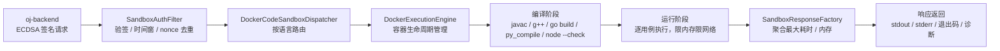

# OJ Code Sandbox 在线判题沙箱

> 一个多语言代码执行沙箱服务：接收用户代码与测试用例，在 Docker 容器中隔离编译、运行并采集资源消耗，为在线判题系统提供安全的代码执行能力。

   

---

## 功能特性

- **多语言支持**：Java、C++、Go、Python、JavaScript 五种语言，各自声明独立的编译/运行命令与资源策略
- **Docker 容器隔离**：编译与运行均在容器内进行，严格限制内存与网络访问，用户代码无法接触宿主机
- **结构化用例执行**：请求携带 `cases[].args[]` 用例参数列表，逐个用例编译执行，输出按行捕获
- **统一结果模型**：返回每个用例的 stdout / stderr / 退出码，聚合最大耗时与最大内存，附带错误诊断
- **ECDSA 请求签名鉴权**：请求头携带 key-id、时间戳、nonce、签名，防伪造、防重放（±300s 时间窗 + nonce 去重）
- **错误诊断清洗**：`DiagnosticSanitizer` 将编译错误等原始输出清洗为精简诊断信息，零输出时自动兜底
- **安全的 Java 运行环境**：Java 沙箱内置 `MySecurityManager`，拒绝危险系统操作
- **可插拔的调度架构**：`CodeSandboxRegistry` + 分发器按语言路由，方便扩展新语言

## 判题架构



- **语言适配**：`LanguageCodeSandbox` 抽象基类 + 各语言 `DockerXxxCodeSandbox`，声明源码文件名、编译/运行命令、挂载卷与环境变量
- **结果语义**：`ExecuteStatusEnum` 区分执行成功、编译失败、运行失败、资源超限；`SandboxFailureType` 归类错误诊断
- **安全边界**：容器 `--network=none`（默认）、内存上限、进程权限收紧；网络访问仅在镜像构建期完成

## 技术栈

| 技术 | 版本 | 用途 |
|------|------|------|
| Java | 1.8 | 开发语言 |
| Spring Boot | 2.7.14 | Web 框架 |
| docker-java | 3.3.0 | Docker API 客户端 |
| Hutool | 5.8.8 | 工具库 |
| Lombok | - | 样板代码生成 |
| Docker | - | 容器隔离执行 |

## 支持的镜像

| 语言 | 镜像 | 编译 | 运行 |
|------|------|------|------|
| Java | `oj-code-sandbox/eclipse-temurin-gson:25-jdk-alpine-2.14.0` | `javac` | `java -cp` |
| C++ | `oj-code-sandbox/gcc-nlohmann-json:15-3.12.0` | `g++ -O2 -std=c++17` | `./main` |
| Go | `golang:1.25-alpine` | `go build` | `./main` |
| Python | `python:3.14-alpine` | `py_compile` | `python` |
| JavaScript | `node:24-alpine` | `node --check` | `node` |

> Go 使用 `oj-gocache` named volume 持久化构建缓存，标准库构建产物跨提交复用，显著缩短判题耗时。

## 快速开始

**前置条件**：JDK 8、Maven 3.6+、可用的 Docker daemon（可设置 `DOCKER_HOST` 指向远程 Docker）

> **Windows 用户注意**：本项目基于 Docker 执行沙箱，Windows 系统下必须在 **WSL2** 环境中启动（原生 Windows 无法直接连接 Docker daemon，会报错）。推荐在 IntelliJ IDEA 中使用**远程开发（Remote Development）**功能连接 WSL2 进行开发调试，本地仅保留 IDE 客户端。

```bash
# 1. 预加载沙箱镜像（首次执行必需）
docker pull python:3.14-alpine
docker pull golang:1.25-alpine
docker pull node:24-alpine
docker pull oj-code-sandbox/eclipse-temurin-gson:25-jdk-alpine-2.14.0
docker pull oj-code-sandbox/gcc-nlohmann-json:15-3.12.0

# 2. 启动服务（自动激活 dev profile，监听 127.0.0.1:8100）
mvn spring-boot:run
```

- **在 IDE 里运行**：加 VM 参数 `-Dspring.profiles.active=dev`。`application.yml` 不设默认 profile，不指定环境时服务不会启动。
- **开发配置已内置开发专用的签名公钥**，与 [my-oj-backend](https://github.com/Huangjl-cn/my-oj-backend) 的 dev 私钥配对，不需要额外配置。这对开发密钥是公开的，所以 dev 默认只监听本机；后端在另一台机器上联调时设 `SERVER_ADDRESS=0.0.0.0`，并确保只在可信网络内访问。

### 调用示例

```bash
curl -X POST http://localhost:8100/executeCode \
  -H "Content-Type: application/json" \
  -H "X-Sandbox-Key-Id: sandbox-key-dev-2026" \
  -H "X-Sandbox-Timestamp: $(date +%s)" \
  -H "X-Sandbox-Nonce: $(uuidgen)" \
  -H "X-Sandbox-Signature: <ECDSA 签名>" \
  -d '{
    "code": "public class Main { public static void main(String[] args) { System.out.println(args[0] + args[1]); } }",
    "language": "java",
    "cases": [{ "args": ["1", "2"] }]
  }'
```

> 签名算法与 oj-backend 的 `SandboxAuthSigner` 配套：规范化字符串为 `timestamp \n nonce \n sha256Hex(body)`，使用 ECDSA 私钥签名。
> 本地联调可先将 `codesandbox.auth.enabled` 置为 `false` 临时关闭鉴权。

## 生产部署

```bash
# 打包
mvn clean package

# 一键安装 systemd 服务（详见 deploy/）
bash deploy/install-oj-sandbox.sh

# 预加载/推送沙箱镜像到服务器
bash deploy/prepare-sandbox-images.sh
```

生产环境由 systemd 管理（`SPRING_PROFILES_ACTIVE=prod`），运行账户 `oj-sandbox` 仅加入 `docker` 组，应用目录 `/opt/oj-code-sandbox`，配置与环境变量位于 `/etc/oj-code-sandbox/`，日志输出到 `/var/log/oj-code-sandbox/`。完整流程见 [server-deployment.md](./docs/server-deployment.md)。

## 项目结构

```
src/main/java/com/hjl/ojcodesandbox/
├── controller/          # HTTP 接口层（/health、/executeCode）
├── CodeSandbox.java     # 沙箱契约（根包）
├── auth/                # ECDSA 请求签名验签过滤器
├── sandbox/
│   ├── dispatch/        # 分发器 + 语言注册表（CodeSandboxRegistry）
│   ├── docker/          # Docker 执行引擎、命令结果、限量输出流
│   ├── language/        # 各语言沙箱实现（Java/C++/Go/Python/JS）
│   └── result/          # 结果模型、错误分类、诊断清洗、响应工厂
├── model/               # 请求/响应/枚举（ExecuteCodeRequest 等）
└── OjCodeSandboxApplication.java
```

## 更多文档

- [沙箱资源隔离方案](./docs/sandbox-resource-isolation.md)
- [沙箱语言实现分析](./docs/sandbox-language-analysis.md)
- [错误诊断清洗逻辑](./docs/diagnostic-sanitizer-logic.md)
- [JSON 运行时依赖镜像构建](./docs/json-dependency-images.md)
- [服务端部署手册](./docs/server-deployment.md)
- [Docker 镜像构建](./docs/docker/)（Java-Gson、C++-nlohmann-json）

## License

[MIT](./LICENSE)
